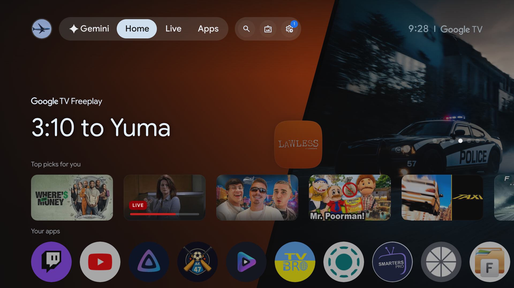
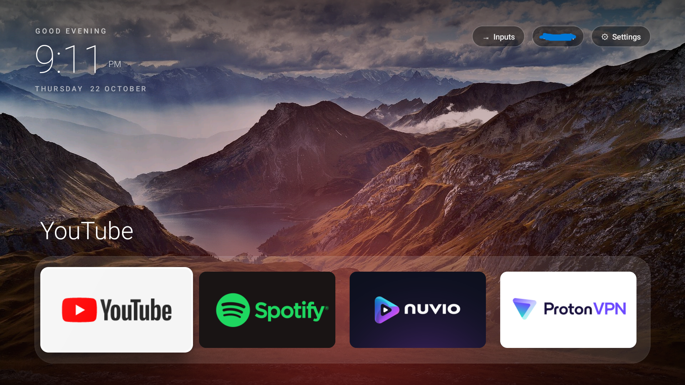
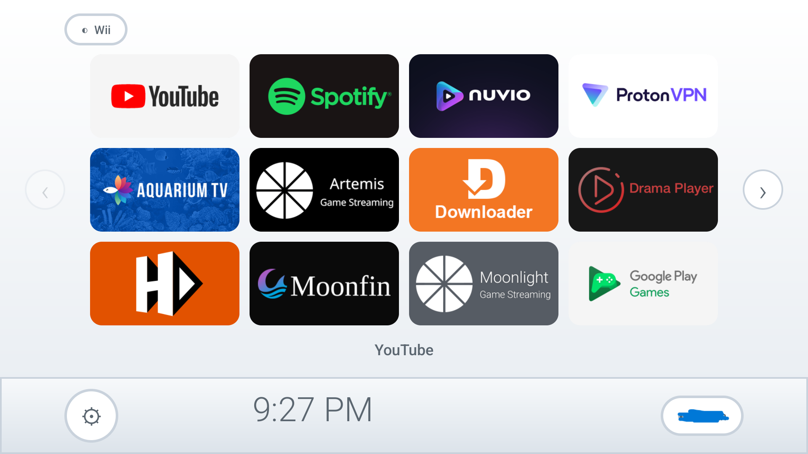

# clean-tv (Windows edition)

Clean up a slow, ad-filled Android TV / Google TV box from a **Windows PC**, then give it a fast,
minimal **Apple TV-style home screen**: a dock of your favourite apps over rotating nature wallpapers,
or an optional light, **Wii-inspired** channel grid.

Everything runs over Wi-Fi with `adb`. Packages are **disabled, never uninstalled**, so every change
can be undone with a script.

> Based on [mihirgupta0900/tv-home](https://github.com/mihirgupta0900/tv-home) (MIT), which targets
> macOS and Claude Code. This edition adds PowerShell scripts for Windows, a hold-to-edit app menu,
> a Wii-inspired theme, and custom wallpapers without rebuilding.

## What you get

- **Backup first.** Package lists, settings, current launcher and a screenshot are saved before any change.
- **Debloat with prompts.** Disables ad-tech, feedback services and streaming apps you don't use, one
  group at a time, with a screenshot check after each. A protected list covers voice, remote, Bluetooth and Play services.
- **A tiny launcher.** Dock, app grid, clock, crossfading wallpapers. No ads, no recommendations, no network use for content.
- **Three looks.** The Apple TV-style dock, a light Wii-inspired grid of channel tiles with pages and a bottom bar, or a dark version of that grid (original artwork only, not affiliated with Nintendo). Switch any time with the Theme button.
- **Hold OK on an app** to Move, Remove from dock, Hide, Unhide apps, Delete (apps you installed) or Reset layout. In the Wii styles, Move works with all four arrows.
- **A pointing hand** glides to whichever tile or button is selected in the Wii styles.
- **One menu for everything.** Double-click `clean-tv.bat` instead of typing the PowerShell commands. The scripts below still work on their own.
- **Wallpaper settings on the TV.** A **Wallpapers** button opens a clean panel: choose Rotating or Static, pick how often
  the photo changes (1 minute to 1 hour), or pick one photo from a grid of previews.
- **Your own wallpapers** pushed from a folder, no rebuild needed. Animated **GIFs** work too.
- **Idle screen.** After a few minutes with nothing pressed, the apps hide and the wallpaper fills the screen with the time
  in the corner. Any button brings the apps back. The delay is set in the Wallpapers panel (Off, 2, 5, 10 or 30 minutes).
- **Undo scripts** for the debloat and for the home screen.

## Screenshots

| Before (stock Google TV, onn 4K) | Apple TV style | Wii style (light) |
|---|---|---|
|  |  |  |

## Tested on

One device: **onn 4K box (Google TV, Android 14)**. The debloat lists are built for that box. On any other
TV, run `-DryRun` first and edit the `$Groups` list at the top of `02-debloat.ps1`.

## Requirements

- Windows 10/11 and a TV on the same Wi-Fi as your PC
- [Android platform-tools](https://developer.android.com/tools/releases/platform-tools) (`winget install Google.PlatformTools`)

## Quick start

1. **TV:** Settings > System > About, click **Build** 7 times. Then Developer options: turn on **USB debugging**
   and **Network debugging** (or Wireless debugging). Note the TV's IP in Settings > Network.
2. **Get the launcher APK.** Download `tvhome.apk` from this repo's **Releases** page.
3. Clone or download this repo. Put `tvhome.apk` in the repo's root folder and open Command Prompt there.
   You can run steps 4 to 6 as commands, or double-click `clean-tv.bat` for a menu. In the menu, press **T**
   and type your TV's IP (like `192.168.1.50`) first, then pick the number shown under each step.
4. Back up the TV (read-only):
   ```
   powershell -ExecutionPolicy Bypass -File .\windows\01-backup.ps1 -TvIp 192.168.1.50
   ```
   Menu: press **1**. Accept **Allow USB debugging?** on the TV (Always allow) and run it again if it stopped.
5. Preview the debloat, then run it:
   ```
   powershell -ExecutionPolicy Bypass -File .\windows\02-debloat.ps1 -DryRun
   powershell -ExecutionPolicy Bypass -File .\windows\02-debloat.ps1
   ```
   Menu: press **2** to preview, then **3** to run it. Read each yes/no carefully. The default is No.
6. Install the home screen:
   ```
   powershell -ExecutionPolicy Bypass -File .\windows\04-install-launcher.ps1
   ```
   Menu: press **6**. Then open an app and press **Home** on the remote to check it returns to the new home screen.

## Commands

Run from the repo root. Prefix each with `powershell -ExecutionPolicy Bypass -File`.

| Script | Does |
|---|---|
| `.\windows\01-backup.ps1 [-TvIp x.x.x.x]` | Backup and inventory. Without `-TvIp` it scans your network. |
| `.\windows\02-debloat.ps1 [-DryRun]` | Disables packages group by group, with prompts. |
| `.\windows\03-restore.ps1` | Re-enables everything the debloat disabled. |
| `.\windows\03-restore.ps1 -Only pkg1,pkg2` | Re-enables only the packages you name. |
| `.\windows\03-restore.ps1 -Everything` | Re-enables everything that was enabled at backup time. |
| `.\windows\04-install-launcher.ps1` | Installs the launcher and makes it your home screen. |
| `.\windows\04-install-launcher.ps1 -Revert` | Goes back to the stock home screen. |
| `.\windows\05-wallpapers.ps1` | Pushes your `wallpapers` folder (1920x1080 .jpg/.png, or animated .gif) to the TV. |
| `.\windows\05-wallpapers.ps1 -Clear` | Goes back to the built-in photos. |
| `.\windows\06-reset-launcher.ps1` | Resets the launcher to defaults (Apple style, default layout). Fixes a stuck cursor. |
| `.\windows\07-screensaver.ps1` | Turns off Google TV's own screensaver so the launcher's idle screen is the only one. Add `-On` to undo. |

If `adb` isn't found, add `-AdbPath "C:\path\to\adb.exe"`.

## Customise

- **On the TV:** hold OK on a tile to rearrange. The layout is saved on the TV.
- **Theme:** press the **Theme** button (top left in the Wii styles, next to Inputs and Wi-Fi in the Apple style) to cycle Apple, Wii and Wii Dark. The Wii styles are a 4x3 grid of channel tiles: press Left on the first column or Right on the last column to change page. They have no dock, so the hold-OK menu there offers Move, Hide, Unhide apps, Delete and Reset layout. The Wii grid keeps its own order, separate from the Apple dock.
- **Wallpapers:** press the **Wallpapers** button (next to Theme). Choose **Rotating** and a delay, or **Static** and tap a preview.
  Your own photos and GIFs come from `05-wallpapers.ps1`; the panel shows how many are on the TV, and GIF previews carry a small GIF tag. The Apple style shows the wallpaper behind the dock;
  the Wii styles use their own background but show it on the idle screen.
- **Idle screen:** set in the Wallpapers panel. Run `07-screensaver.ps1` once so Google TV's own screensaver does not start first.

## Troubleshooting

- **`adb` not found:** open a new terminal after installing, or use `-AdbPath`.
- **`failed to authenticate`:** accept the **Allow USB debugging?** prompt on the TV.
- **Cursor stuck after updating while on a Wii theme:** older builds could start with focus on a hidden tile. Reset the launcher with `adb shell pm clear com.mihir.tvhome` (add `-s <TV_IP>:5555` if adb says more than one device), which returns it to the Apple style. Fixed in newer builds. To be safe on an old build, switch to the Apple theme before installing a new `tvhome.apk`.
- **A GIF wallpaper stutters:** small TV boxes can struggle with big animations. Keep GIFs under about 15 MB and no larger than 1920x1080
  (shorter and smaller is smoother). The launcher scales big ones down, and animation pauses while you are in another app.
- **Custom wallpapers do not seem to change:** the default is one photo every 10 minutes, and a photo that cannot be read is skipped.
  Open the **Wallpapers** panel to shorten the delay. If it says 0 of your photos, push them again with `05-wallpapers.ps1`
  (reinstalling or resetting the launcher removes them). Check with `adb shell ls -l /sdcard/Android/data/com.mihir.tvhome/files/wallpapers`.
- **`adb: more than one device/emulator`:** add `-s <TV_IP>:5555` to the adb command.
- **`INSTALL_FAILED_UPDATE_INCOMPATIBLE`:** the installed launcher was signed with a different key.
  `04-install-launcher.ps1` offers to switch back to the stock home, remove it and reinstall. 
- **Home button misbehaves:** run `04-install-launcher.ps1 -Revert`. On Google TV the setup app
  (`com.google.android.tungsten.setupwraith`) can hijack Home, which is why the script disables it with the stock launcher.
- **Wi-Fi forgot its password after the swap:** it happened once on the tested box. Re-enter it.
- **The Wi-Fi label shows "Wi-Fi" instead of your network name:** Android only shares the network name with apps that
  have location access. `04-install-launcher.ps1` grants it automatically. If you installed the APK another way, run
  `adb shell pm grant com.mihir.tvhome android.permission.ACCESS_FINE_LOCATION`, and make sure the TV's location
  setting is on. The label shows "Offline" only when the TV has no connection.

## Safety

- Use at your own risk. This is not affiliated with Google, Walmart/onn, Nintendo or any TV maker.
- Your `backups/` folder contains device identifiers and copies of installed APKs. It is git-ignored; never publish it.
- The scripts only run `pm disable-user`, `pm enable`, `adb install`, and `adb uninstall` of the launcher itself.
  The Delete option in the launcher uses Android's own uninstall dialog.

## Credits and licence

- Launcher and original tooling: [Mihir Gupta](https://github.com/mihirgupta0900/tv-home), MIT.
- Windows scripts and launcher changes: this repo's contributors, MIT. See [LICENSE](LICENSE).
- Wallpapers are from Wikimedia Commons under CC BY-SA. Attribution is in
  [`launcher/WALLPAPER-CREDITS.md`](launcher/WALLPAPER-CREDITS.md).
